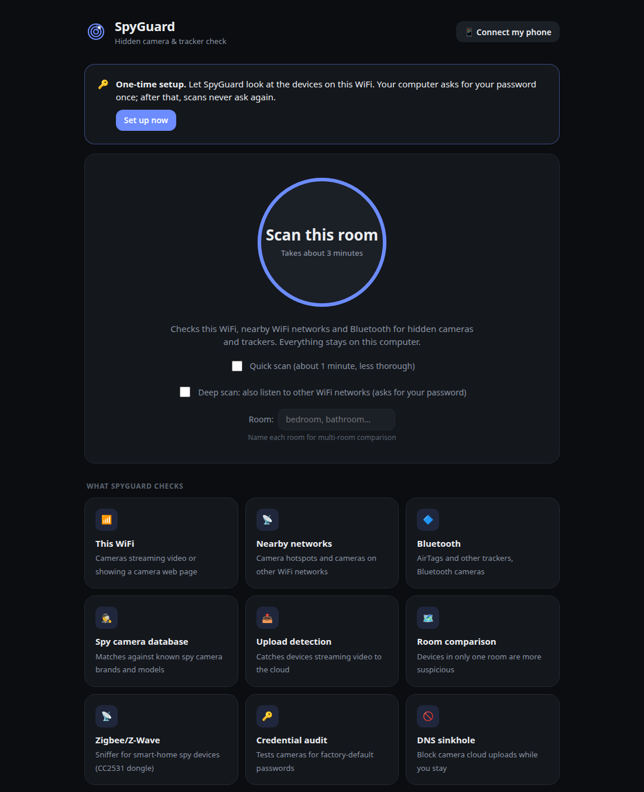
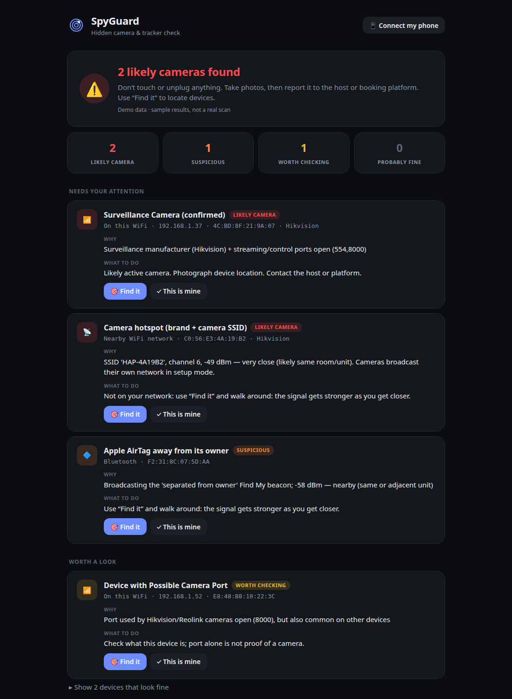

<h1 align="center">SpyGuard</h1>

<p align="center">
  <b>Find hidden cameras and trackers in hotel rooms and rentals.</b><br>
  An Android app and a Linux laptop scanner — everything runs on your own devices.
</p>

<p align="center">
  
  
  
  
</p>

SpyGuard scans your WiFi, nearby WiFi networks, and Bluetooth for hidden cameras and trackers, and gives you a
plain-language verdict in about three minutes. It can also find cameras that are switched off, using your phone's
camera (lens reflections) and magnetometer. **No account, no cloud — nothing ever leaves your phone or laptop.**

<p align="center">
  
  
</p>

<p align="center">
  
  
  
  
</p>
<p align="center"><sub>Screenshots use the app's built-in demo data, not a real scan.</sub></p>

## Download

**Android** — download `spyguard-<version>-arm64.apk` from the [latest release](../../releases/latest), open it on
your phone, and allow "install unknown apps" when asked. Requires Android 7.0+ on a 64-bit phone.

**Linux laptop** — see [Laptop app](#laptop-app) below.

## What it finds

| | Phone app | Laptop scanner |
|---|:---:|:---:|
| Cameras on your WiFi (RTSP video, camera web pages, camera ports) | ✅ | ✅ (+ manufacturer by MAC) |
| **Known spy-camera database** (V380, XMEye, ESP32-CAM, 100+ models) | ✅ | ✅ |
| Camera setup hotspots and camera-brand networks nearby | ✅ | ✅ |
| AirTag / Find My, Google Find My, Tile, SmartTag, Chipolo trackers | ✅ | ✅ |
| **Network traffic anomaly detection** (P2P relay, sustained uploads) | — | ✅ |
| Cameras talking on **other** WiFi networks (monitor mode) | — | ✅ Linux + root |
| Switched-off / offline cameras (lens glint, infrared LEDs) | ✅ Lens tab | ✅ `--optical` |
| Electronics hidden in objects (magnetometer) | ✅ Magnet tab | — |
| Walk to a device with a hot/cold signal meter | ✅ Find tab | ✅ `--locate`, `--survey` |
| **RF signal heatmap** (map signal strength around the room) | ✅ Heatmap tab | — |
| **Multi-room comparison** (flag devices unique to one room) | ✅ Settings | ✅ `--room`, `--compare-rooms` |
| **Scheduled background scans** with push notifications | ✅ Settings | ✅ `--watch` |
| **Ultrasonic beacon detection** (18-22 kHz microphone analysis) | ✅ during scan | — |
| **Thermal anomaly hints** (import FLIR/Seek images, mark hot spots) | ✅ Thermal tab | — |
| **Device timeline** (track presence patterns, flag night-only devices) | ✅ Settings | ✅ `timeline.py` |
| **DNS sinkhole** (block camera cloud uploads via /etc/hosts) | — | ✅ `sinkhole.py` |
| **ONVIF credential audit** (test for factory-default passwords) | — | ✅ `onvif_audit.py` |
| **Zigbee/Z-Wave sniffer** (CC2531 dongle, smart-home cameras) | — | ✅ `zigbee.py` |
| Distance estimation for BLE devices | ✅ | — |
| Evidence pack, watch mode, trusted devices | trusted devices | ✅ |

Every check is **detection-only**: SpyGuard never logs into devices, joins other people's networks
or decrypts traffic. The ONVIF audit tests known factory-default credentials only.

## Android app

Five tabs:

- **Scan** — one tap to check WiFi, nearby networks, and Bluetooth (includes ultrasonic beacon detection)
- **Find** — hot/cold locator with vibration: walk toward a flagged device
- **Lens** — flashlight + red filter with automatic lens/infrared reflection detection
- **Magnet** — magnetometer sweep to find electronics hidden inside objects
- **More** — trusted devices, laptop link, scheduled auto-scans, room comparison, device timeline, plus the
  **Heatmap** (map signal strength around a room) and **Thermal** (import FLIR/Seek images) tools

Source and build instructions: [`mobile/`](mobile/README.md).

Link the phone to the laptop scanner to see the laptop's results, including other-network detection, in the app:
click **Connect my phone** in the laptop app (or run `./privacy-scan --serve`) and scan the QR code under
**Settings → Laptop scanner**.

## Laptop app

A simple desktop app for Linux: one big **Scan this room** button, progress in plain words, and a clear verdict with
what to do. No terminal needed once it's installed. (Screenshots at the top of this page.)

**Install once:**

```bash
sudo apt install -y nmap arp-scan avahi-utils    # Debian/Ubuntu (see Prerequisites for others)
git clone https://github.com/anascs12/spyguard.git && cd spyguard
./spyguard --install                             # adds SpyGuard to your applications menu
```

Then open **SpyGuard** from your applications menu. It opens in its own window without asking for a password.
The first time, click **Set up now**: your computer asks for your password once so SpyGuard can look at the devices
on your WiFi, and never again after that. Results are saved in `~/SpyGuard/`.

- **Deep scan** (optional checkbox) also listens for cameras on *other* WiFi networks. Only this asks for your
  password, each time you choose it, because it needs full administrator rights.

- **Find it** shows a hot/cold meter to walk to a flagged device
- **Connect my phone** shows a QR code: scan it in the phone app to see the laptop's results there
- **This is mine** stops your own devices from being flagged again
- The app stops its background service a minute after you close the window
- No terminal? `./spyguard --setup` does the same one-time setup

Prefer the terminal? `./privacy-scan --lang en` runs the same scanner with full options (described below).

## Running scan.py directly

```bash
# Cross-platform (Python — recommended)
sudo python3 scripts/scan.py           # Linux / macOS
python scripts\scan.py                  # Windows (Admin PowerShell)

# Linux-only (Bash)
sudo bash scripts/scan.sh
```

## Prerequisites

### All platforms: nmap (mandatory) + Python 3.8+

| Platform | nmap | Python | Extras |
|----------|------|--------|--------|
| **Linux (Arch)** | `sudo pacman -S nmap` | `sudo pacman -S python` | `arp-scan avahi` (recommended) |
| **Linux (Debian)** | `sudo apt install nmap` | `sudo apt install python3` | `arp-scan avahi-utils` |
| **macOS** | `brew install nmap` | `brew install python` | `arp-scan` (recommended) |
| **Windows** | [nmap.org/download](https://nmap.org/download) (includes Npcap) | [python.org](https://python.org) | — |

### Python packages (optional, improve detection)

```bash
pip install python-nmap zeroconf requests
# or
pip install -r requirements.txt
```

Without these packages, the scanner still works using nmap subprocess calls. With them, you get better mDNS discovery and HTTP inspection.

## Usage

```bash
# Full auto-detect (Portuguese report by default)
sudo python3 scripts/scan.py

# Report in English or Spanish
sudo python3 scripts/scan.py --lang en
sudo python3 scripts/scan.py --lang es

# Quick mode (skip service discovery & deep inspection)
sudo python3 scripts/scan.py --quick

# Specify WiFi interface or subnet
sudo python3 scripts/scan.py --interface wlan0
sudo python3 scripts/scan.py --subnet 192.168.1.0/24

# Custom output directory
sudo python3 scripts/scan.py --output-dir /tmp/my-scan

# Skip HTML report
sudo python3 scripts/scan.py --no-html

# Show help
python3 scripts/scan.py --help
```

### Beyond your WiFi network

By default a full scan also checks:

- **Nearby WiFi networks:** camera setup hotspots (`IPC-…`, `V380…`, `HDWiFiCam…`), camera-brand access points, hidden SSIDs
- **Bluetooth LE:** AirTag / Find My, Google Find My Device, Tile, SmartTag, Chipolo, BLE camera names (needs `bleak`)
- **Over-the-air capture (Linux, root):** listens on every WiFi channel in monitor mode and flags
  camera-brand devices and devices with constant one-way upload traffic (how a live video stream looks)
  on **any nearby network**, with a signal-based distance estimate. Passive only: nothing joins,
  disconnects or decrypts other networks.

```bash
sudo python3 scripts/scan.py --monitor wlan1        # use a second USB adapter (full channel coverage)
sudo python3 scripts/scan.py --monitor-time 180     # listen longer
sudo python3 scripts/scan.py --no-monitor --no-ble  # LAN + access points only
```

With only the built-in WiFi card, the capture can pause your connection and may be limited to one
channel. A USB adapter that supports monitor mode (e.g. Alfa AWUS036ACM) gives full coverage.

### Finding where a device is

Every flagged device includes the commands to locate it.

```bash
# Live hot/cold signal meter: walk around and watch it rise
sudo python3 scripts/scan.py --locate mon:AA:BB:CC:DD:EE:FF   # any WiFi device, incl. other networks
python3 scripts/scan.py --locate wifi:AA:BB:CC:DD:EE:FF       # an access point / camera hotspot
python3 scripts/scan.py --locate ble:AA:BB:CC:DD:EE:FF        # a Bluetooth tracker
python3 scripts/scan.py --locate 192.168.1.37                 # latency only (weak hint)

# Guided survey: measure at 3+ spots ("door 0,0", "bed 3.5,2") -> closest spot + x,y estimate
sudo python3 scripts/scan.py --survey mon:AA:BB:CC:DD:EE:FF
```

Signal strength indoors is noisy: expect the estimate to be within about 1-3 m, then search by hand.

### Cameras that are offline or powered off

These send no radio signal, so the optical finder looks for them instead. A camera lens reflects
light straight back to its source, whether the camera is on or off, and night-vision cameras glow in
infrared.

```bash
python3 scripts/scan.py --optical 0               # live webcam
python3 scripts/scan.py --optical sweep.mp4       # video you recorded on your phone
```

Darken the room, keep a light right next to the camera, and sweep slowly. The tool saves a snapshot of
every bright point that stays fixed on an object. Needs `opencv-python`.

### Tracking changes and evidence

```bash
sudo python3 scripts/scan.py --trust AA:BB:CC:DD:EE:FF=my-phone   # never flag your own devices
sudo python3 scripts/scan.py --watch 10                           # re-scan every 10 min, alert on new devices
sudo python3 scripts/scan.py --evidence                           # zip of reports + raw data + SHA-256 manifest
```

Devices are remembered per network (by router MAC), so later scans mark new arrivals as **[NEW]**.

### Multi-room comparison

Save a scan per room, then compare to find devices that appear in only one — more suspicious than a
router that shows up everywhere.

```bash
sudo python3 scripts/scan.py --room bedroom
sudo python3 scripts/scan.py --room bathroom
sudo python3 scripts/scan.py --compare-rooms        # highlight single-room devices
```

The mobile app has the same feature under Settings → Room comparison.

### Device timeline

Track which devices appear and disappear over hours. A camera that only shows up at night is more
suspicious than one that's always on.

```bash
sudo python3 scripts/timeline.py --record           # save a snapshot now
sudo python3 scripts/timeline.py --show             # display timeline
sudo python3 scripts/timeline.py --watch 15         # auto-record every 15 min
sudo python3 scripts/timeline.py --suspicious       # show devices with unusual patterns
```

The mobile app automatically builds a timeline from every scan (Settings → Device timeline).

### DNS sinkhole

Block spy-camera cloud uploads by redirecting known P2P camera domains to 127.0.0.1. While active,
cameras on the local network cannot phone home.

```bash
sudo python3 scripts/sinkhole.py --enable           # block camera cloud domains
sudo python3 scripts/sinkhole.py --disable          # restore /etc/hosts
sudo python3 scripts/sinkhole.py --status           # show current state
```

### ONVIF credential audit

Test discovered cameras for factory-default passwords. Detection-only: reports which cameras are
unsecured, never streams or changes any settings.

```bash
python3 scripts/onvif_audit.py 192.168.1.100        # single IP
python3 scripts/onvif_audit.py --from-scan results.json  # audit all HIGH+ from a scan
```

### Zigbee / Z-Wave sniffer

Detect smart-home spy devices on 802.15.4 and Z-Wave. Requires a CC2531 USB dongle (Zigbee) or a
Z-Wave USB stick.

```bash
sudo python3 scripts/zigbee.py                      # auto-detect dongle
sudo python3 scripts/zigbee.py --channel 15         # specific Zigbee channel
sudo python3 scripts/zigbee.py --zwave              # also scan Z-Wave
sudo python3 scripts/zigbee.py --duration 120       # listen for 2 min
```

### Windows (Admin PowerShell)

```powershell
python scripts\scan.py
python scripts\scan.py --quick --lang en
```

## What It Scans

**Pipeline:**

1. **Host Discovery** — Find all devices via ARP scan + nmap ping scan (with hostnames)
2. **OUI Analysis** — Identify manufacturers from MAC addresses, flag camera brands and camera hostnames
3. **Port Scan** — Check 20 camera-specific ports (RTSP, HTTP, vendor-proprietary)
4. **Service Discovery** — mDNS/Bonjour, UPnP/SSDP, ONVIF WS-Discovery with device model lookup
4b. **Nearby Wireless** — Other WiFi networks' access points, Bluetooth LE trackers and cameras
5. **Deep Inspection** — HTTP banner grabbing, real RTSP handshake, spy-camera firmware fingerprinting
5b. **Over-the-Air Capture** — Monitor mode on all channels: cameras on any nearby network
5c. **Traffic Anomaly Detection** — DNS cache, conntrack, and upload monitoring for P2P camera traffic
6. **Risk Classification** — Spy-device database + all evidence → risk levels, trust list and baseline
7. **Report** — Terminal output + HTML report + JSON

## Risk Levels

| Level | Meaning | Example |
|-------|---------|---------|
| 🔴 CRITICAL | Confirmed camera/streaming | Hikvision device with RTSP port open |
| 🟠 HIGH | Strong camera indicators | Wyze MAC address detected |
| 🟡 MODERATE | Suspicious/unidentified | Unknown device with HTTP server |
| 🟢 LOW | Probably safe | ESP32 device without camera ports |
| 🔵 INFO | Known safe | iPhone, laptop, printer |

## Output

- **Terminal**: Color-coded real-time output with risk-classified device list
- **HTML Report**: `./privacy-scan-results/privacy-scan-YYYYMMDD-HHMMSS.html`
  - Dark security-themed UI with animated scanning elements
  - Interactive device cards (click to expand, copy IP/MAC)
  - Live language switcher (PT / EN / ES) — no reload needed
  - Print-friendly mode (Ctrl+P)
  - Fully self-contained — works offline, no external dependencies
- **JSON**: `./privacy-scan-results/privacy-scan-YYYYMMDD-HHMMSS.json` (machine-readable)
- **Evidence pack** (`--evidence`): `./privacy-scan-results/evidence-YYYYMMDD-HHMMSS.zip`

## Limitations

Radio-based detection **cannot** see:

- Wired-only cameras (Ethernet/PoE) on another network
- Cellular-connected cameras (4G/LTE)
- Powered-off or SD-card-only cameras (use `--optical` for these)
- Audio-only recording devices (bugs)

Optical detection needs line of sight and can be fooled by glass, screws or water drops.

**Always complement with a physical inspection.**

## Rental Platform Policies

Major short-term rental platforms prohibit indoor surveillance cameras:

- **[Airbnb](https://www.airbnb.com/help/article/3061)** — All indoor cameras prohibited, even if off. Hidden cameras always banned. Outdoor cameras must be disclosed.
- **[Booking.com](https://partner.booking.com/en-us/help/legal-security/security/requirements-and-regulations-surveillance-devices)** — Cameras allowed only in common/public areas, must be visible and disclosed. Prohibited where guests expect privacy.
- **[Vrbo](https://www.vrbo.com/tlp/trust-and-safety/use-of-surveillance-policy)** — Indoor cameras prohibited. Outdoor cameras allowed only for security at access points, must be disclosed.

## License

Apache License 2.0 — see [LICENSE](LICENSE) for details.

This tool is for **defensive security purposes only** — helping guests detect unauthorized surveillance in rental properties. Use responsibly and in accordance with local laws.
