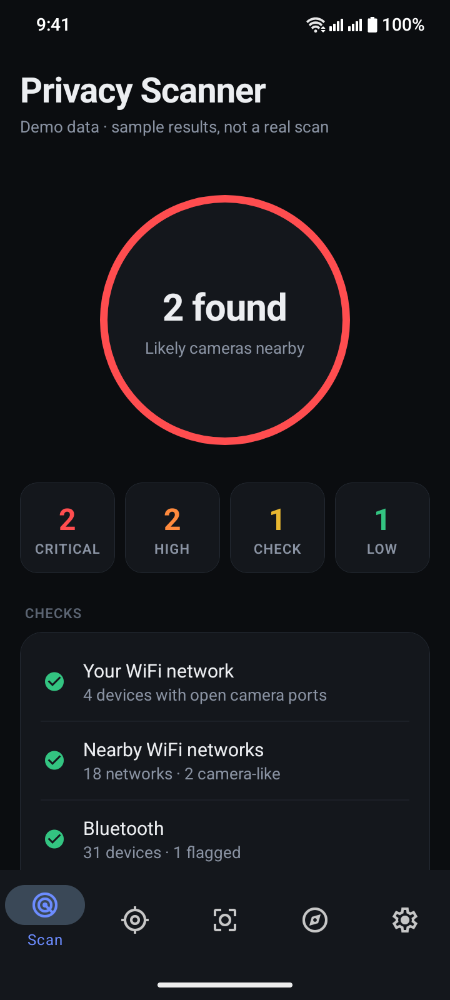
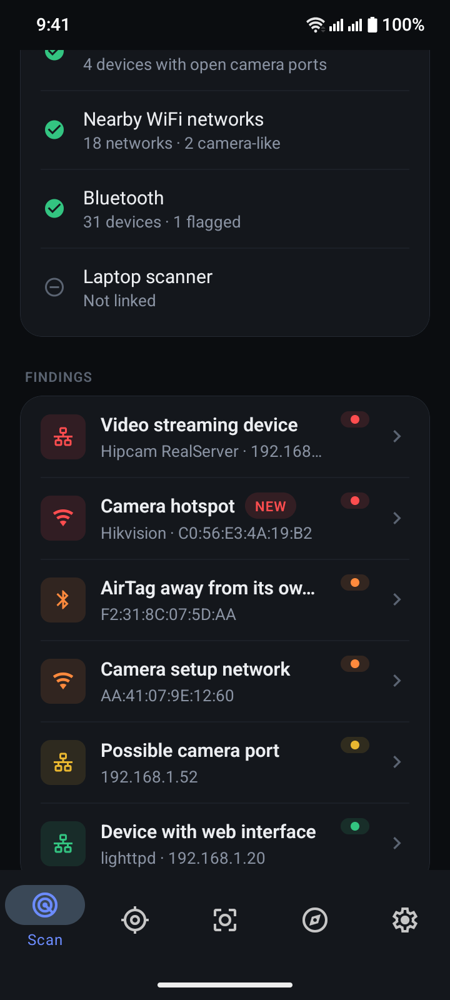
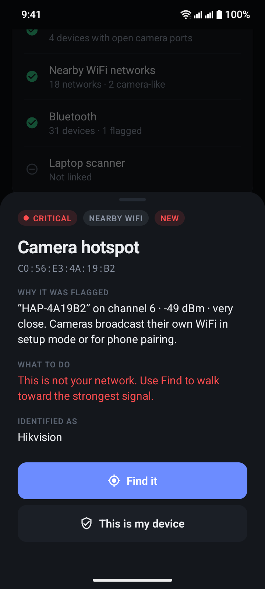
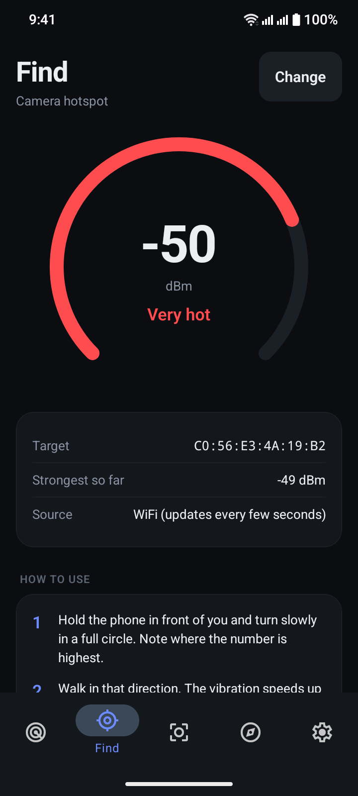
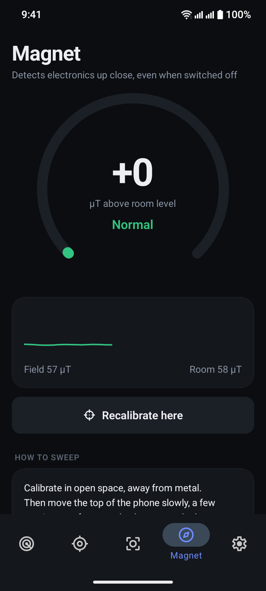
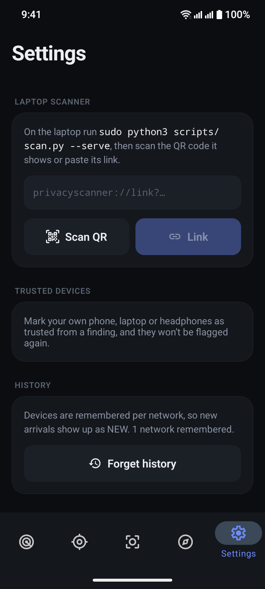

# SpyGuard

**Find hidden cameras and trackers in hotel rooms and rentals: an Android app plus a laptop scanner.**

SpyGuard checks your WiFi network, nearby WiFi networks and Bluetooth for cameras and trackers. It also helps you
find cameras that are switched off or offline, using your phone's camera (lens reflections) and its magnetometer.
Everything runs on your own devices: no account, no cloud, nothing leaves your phone or laptop.

<p align="center">
  
  
  
</p>
<p align="center">
  
  
  
</p>
<p align="center"><sub>Screenshots use the app's built-in demo data, not a real scan.</sub></p>

## Download

**Android:** grab `spyguard-<version>-arm64.apk` from the [latest release](../../releases/latest) and open it on your
phone (allow "install unknown apps" when asked). Android 7.0+ on a 64-bit phone.

## What it finds

| | Phone app | Laptop scanner |
|---|:---:|:---:|
| Cameras on your WiFi (RTSP video, camera web pages, camera ports) | ✅ | ✅ (+ manufacturer by MAC) |
| Camera setup hotspots and camera-brand networks nearby | ✅ | ✅ |
| AirTag / Find My, Google Find My, Tile, SmartTag, Chipolo trackers | ✅ | ✅ |
| Cameras talking on **other** WiFi networks (monitor mode) | — | ✅ Linux + root |
| Switched-off / offline cameras (lens glint, infrared LEDs) | ✅ Lens tab | ✅ `--optical` |
| Electronics hidden in objects (magnetometer) | ✅ Magnet tab | — |
| Walk to a device with a hot/cold signal meter | ✅ Find tab | ✅ `--locate`, `--survey` |
| Evidence pack, watch mode, trusted devices | trusted devices | ✅ |

Every check is **detection-only**: SpyGuard never logs into devices, guesses passwords, joins other people's networks
or decrypts traffic.

## Android app

Five tabs: **Scan** (one tap), **Find** (hot/cold locator with vibration), **Lens** (flashlight + red filter +
automatic lens/IR detection), **Magnet** (magnetometer sweep) and **Settings** (trusted devices, laptop link).
Source and build instructions: [`mobile/`](mobile/README.md).

Link the phone to the laptop scanner to see the laptop's results, including other-network detection, in the app:
run `./privacy-scan --serve` and scan the QR code under **Settings → Laptop scanner**.

## Laptop scanner

```bash
sudo apt install -y nmap arp-scan avahi-utils   # Debian/Ubuntu (see Prerequisites for others)
./privacy-scan --lang en                        # sets up a Python venv on first run, then scans
```

`./privacy-scan` passes any option through to `scripts/scan.py`; the rest of this document describes them.

## Running scan.py directly

```bash
# Cross-platform (Python — recommended)
sudo python3 scripts/scan.py           # Linux / macOS
python scripts\scan.py                  # Windows (Admin PowerShell)

# Linux-only (Bash)
sudo bash scripts/scan.sh
```

## Prerequisites

### All platforms: nmap (mandatory) + Python 3.8+

| Platform | nmap | Python | Extras |
|----------|------|--------|--------|
| **Linux (Arch)** | `sudo pacman -S nmap` | `sudo pacman -S python` | `arp-scan avahi` (recommended) |
| **Linux (Debian)** | `sudo apt install nmap` | `sudo apt install python3` | `arp-scan avahi-utils` |
| **macOS** | `brew install nmap` | `brew install python` | `arp-scan` (recommended) |
| **Windows** | [nmap.org/download](https://nmap.org/download) (includes Npcap) | [python.org](https://python.org) | — |

### Python packages (optional, improve detection)

```bash
pip install python-nmap zeroconf requests
# or
pip install -r requirements.txt
```

Without these packages, the scanner still works using nmap subprocess calls. With them, you get better mDNS discovery and HTTP inspection.

## Usage

```bash
# Full auto-detect (Portuguese report by default)
sudo python3 scripts/scan.py

# Report in English or Spanish
sudo python3 scripts/scan.py --lang en
sudo python3 scripts/scan.py --lang es

# Quick mode (skip service discovery & deep inspection)
sudo python3 scripts/scan.py --quick

# Specify WiFi interface or subnet
sudo python3 scripts/scan.py --interface wlan0
sudo python3 scripts/scan.py --subnet 192.168.1.0/24

# Custom output directory
sudo python3 scripts/scan.py --output-dir /tmp/my-scan

# Skip HTML report
sudo python3 scripts/scan.py --no-html

# Show help
python3 scripts/scan.py --help
```

### Beyond your WiFi network

By default a full scan also checks:

- **Nearby WiFi networks:** camera setup hotspots (`IPC-…`, `V380…`, `HDWiFiCam…`), camera-brand access points, hidden SSIDs
- **Bluetooth LE:** AirTag / Find My, Google Find My Device, Tile, SmartTag, Chipolo, BLE camera names (needs `bleak`)
- **Over-the-air capture (Linux, root):** listens on every WiFi channel in monitor mode and flags
  camera-brand devices and devices with constant one-way upload traffic (how a live video stream looks)
  on **any nearby network**, with a signal-based distance estimate. Passive only: nothing joins,
  disconnects or decrypts other networks.

```bash
sudo python3 scripts/scan.py --monitor wlan1        # use a second USB adapter (full channel coverage)
sudo python3 scripts/scan.py --monitor-time 180     # listen longer
sudo python3 scripts/scan.py --no-monitor --no-ble  # LAN + access points only
```

With only the built-in WiFi card, the capture can pause your connection and may be limited to one
channel. A USB adapter that supports monitor mode (e.g. Alfa AWUS036ACM) gives full coverage.

### Finding where a device is

Every flagged device includes the commands to locate it.

```bash
# Live hot/cold signal meter: walk around and watch it rise
sudo python3 scripts/scan.py --locate mon:AA:BB:CC:DD:EE:FF   # any WiFi device, incl. other networks
python3 scripts/scan.py --locate wifi:AA:BB:CC:DD:EE:FF       # an access point / camera hotspot
python3 scripts/scan.py --locate ble:AA:BB:CC:DD:EE:FF        # a Bluetooth tracker
python3 scripts/scan.py --locate 192.168.1.37                 # latency only (weak hint)

# Guided survey: measure at 3+ spots ("door 0,0", "bed 3.5,2") -> closest spot + x,y estimate
sudo python3 scripts/scan.py --survey mon:AA:BB:CC:DD:EE:FF
```

Signal strength indoors is noisy: expect the estimate to be within about 1-3 m, then search by hand.

### Cameras that are offline or powered off

These send no radio signal, so the optical finder looks for them instead. A camera lens reflects
light straight back to its source, whether the camera is on or off, and night-vision cameras glow in
infrared.

```bash
python3 scripts/scan.py --optical 0               # live webcam
python3 scripts/scan.py --optical sweep.mp4       # video you recorded on your phone
```

Darken the room, keep a light right next to the camera, and sweep slowly. The tool saves a snapshot of
every bright point that stays fixed on an object. Needs `opencv-python`.

### Tracking changes and evidence

```bash
sudo python3 scripts/scan.py --trust AA:BB:CC:DD:EE:FF=my-phone   # never flag your own devices
sudo python3 scripts/scan.py --watch 10                           # re-scan every 10 min, alert on new devices
sudo python3 scripts/scan.py --evidence                           # zip of reports + raw data + SHA-256 manifest
```

Devices are remembered per network (by router MAC), so later scans mark new arrivals as **[NEW]**.

### Windows (Admin PowerShell)

```powershell
python scripts\scan.py
python scripts\scan.py --quick --lang en
```

## What It Scans

**Pipeline:**

1. **Host Discovery** — Find all devices via ARP scan + nmap ping scan (with hostnames)
2. **OUI Analysis** — Identify manufacturers from MAC addresses, flag camera brands and camera hostnames
3. **Port Scan** — Check 20 camera-specific ports (RTSP, HTTP, vendor-proprietary)
4. **Service Discovery** — mDNS/Bonjour, UPnP/SSDP, ONVIF WS-Discovery with device model lookup
4b. **Nearby Wireless** — Other WiFi networks' access points, Bluetooth LE trackers and cameras
5. **Deep Inspection** — HTTP banner grabbing, real RTSP handshake (detects password-free video streams)
5b. **Over-the-Air Capture** — Monitor mode on all channels: cameras on any nearby network
6. **Risk Classification** — Correlate all evidence into risk levels, apply trust list and baseline
7. **Report** — Terminal output + HTML report + JSON

## Risk Levels

| Level | Meaning | Example |
|-------|---------|---------|
| 🔴 CRITICAL | Confirmed camera/streaming | Hikvision device with RTSP port open |
| 🟠 HIGH | Strong camera indicators | Wyze MAC address detected |
| 🟡 MODERATE | Suspicious/unidentified | Unknown device with HTTP server |
| 🟢 LOW | Probably safe | ESP32 device without camera ports |
| 🔵 INFO | Known safe | iPhone, laptop, printer |

## Output

- **Terminal**: Color-coded real-time output with risk-classified device list
- **HTML Report**: `./privacy-scan-results/privacy-scan-YYYYMMDD-HHMMSS.html`
  - Dark security-themed UI with animated scanning elements
  - Interactive device cards (click to expand, copy IP/MAC)
  - Live language switcher (PT / EN / ES) — no reload needed
  - Print-friendly mode (Ctrl+P)
  - Fully self-contained — works offline, no external dependencies
- **JSON**: `./privacy-scan-results/privacy-scan-YYYYMMDD-HHMMSS.json` (machine-readable)
- **Evidence pack** (`--evidence`): `./privacy-scan-results/evidence-YYYYMMDD-HHMMSS.zip`

## Limitations

Radio-based detection **cannot** see:

- Wired-only cameras (Ethernet/PoE) on another network
- Cellular-connected cameras (4G/LTE)
- Powered-off or SD-card-only cameras (use `--optical` for these)
- Audio-only recording devices (bugs)

Optical detection needs line of sight and can be fooled by glass, screws or water drops.

**Always complement with a physical inspection.**

## Rental Platform Policies

Major short-term rental platforms prohibit indoor surveillance cameras:

- **[Airbnb](https://www.airbnb.com/help/article/3061)** — All indoor cameras prohibited, even if off. Hidden cameras always banned. Outdoor cameras must be disclosed.
- **[Booking.com](https://partner.booking.com/en-us/help/legal-security/security/requirements-and-regulations-surveillance-devices)** — Cameras allowed only in common/public areas, must be visible and disclosed. Prohibited where guests expect privacy.
- **[Vrbo](https://www.vrbo.com/tlp/trust-and-safety/use-of-surveillance-policy)** — Indoor cameras prohibited. Outdoor cameras allowed only for security at access points, must be disclosed.

## If You Find a Camera

1. Do NOT disconnect or tamper with it
2. Photograph the device and its location
3. Save the scan report as evidence
4. Contact Airbnb: App → Your Trips → Get Help → Report a safety concern
5. Airbnb Emergency: +1-855-424-7262
6. Leave if you feel unsafe
7. Consider contacting local law enforcement

## As a Claude Code Skill

Install by copying this directory to your Claude Code skills path. The skill triggers on phrases like "scan for cameras", "hidden camera", "privacy scan", "surveillance scan", etc.

## Credits and license

SpyGuard builds on [privacy-scanner](https://github.com/maluta/privacy-scanner) by
[Tiago Maluta](https://github.com/maluta), who created the original laptop scanner (see [AUTHORS](AUTHORS)).

Apache License 2.0 — see [LICENSE](LICENSE) for details.

This tool is for **defensive security purposes only** — helping guests detect unauthorized surveillance in rental properties. Use responsibly and in accordance with local laws.
